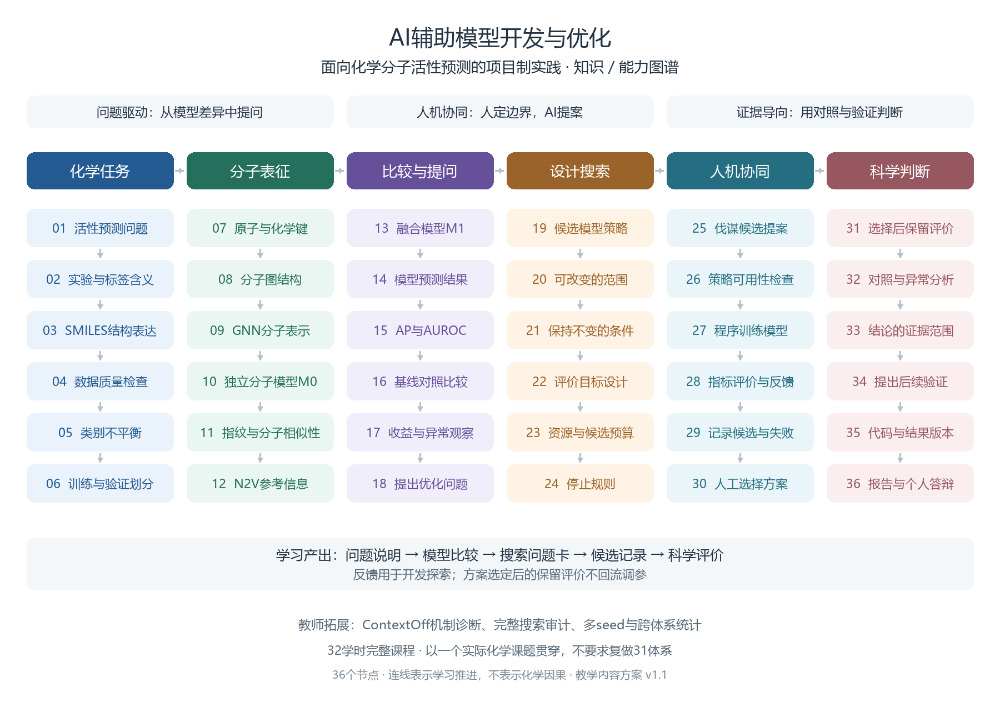

# 知识／能力图谱

本图以学生学习活动为主线，共36节点，按六个学习维度组织，贯穿以实际课题开展的32学时完整课程。六个图谱维度与五个教学阶段相互对应，不要求一一等长。图中连线表示学习推进，不表示化学因果关系。



可编辑矢量源为 `assets/knowledge-map.svg`，绘图源代码为 `scripts/build_knowledge_map.py`。PNG与SVG由同一组节点和版面参数生成；PNG供浏览，SVG供插入信息表时缩放。

| 阶段 | 节点 | 主要能力 |
|---|---|---|
| 化学任务 | 01活性预测问题、02实验与标签含义、03SMILES结构表达、04数据质量检查、05类别不平衡、06训练与验证划分 | 定义问题与理解数据 |
| 分子表征 | 07原子与化学键、08分子图结构、09GNN分子表示、10独立分子模型M0、11指纹与分子相似性、12N2V参考信息 | 解释模型使用的信息 |
| 比较与提问 | 13融合模型M1、14模型预测结果、15AP与AUROC、16基线对照比较、17收益与异常观察、18提出优化问题 | 从证据中提出可检验问题 |
| 设计搜索 | 19候选模型策略、20可改变的范围、21保持不变的条件、22评价目标设计、23资源与候选预算、24停止规则 | 设计AI辅助模型开发任务 |
| 人机协同 | 25伐谋候选提案、26策略可用性检查、27程序训练模型、28指标评价与反馈、29记录候选与失败、30人工选择方案 | 参与提案、执行和评价反馈 |
| 科学判断 | 31选择后保留评价、32对照与异常分析、33结论的证据范围、34提出后续验证、35代码与结果版本、36报告与个人答辩 | 用证据形成结论并表达 |

36节点是在第一阶段草案基础上按教学重点重新组织，不要求学生完成原科研全矩阵。复杂搜索审计、ContextOff功能分解、多seed与跨体系统计放入教师拓展。

重新生成预览需Pillow，并提供支持中文的字体：

```bash
python scripts/build_knowledge_map.py --font "中文字体文件路径"
```

本机已使用微软雅黑生成。其他操作系统可指定Noto Sans CJK等可用字体，不声称默认字体路径跨平台有效。
