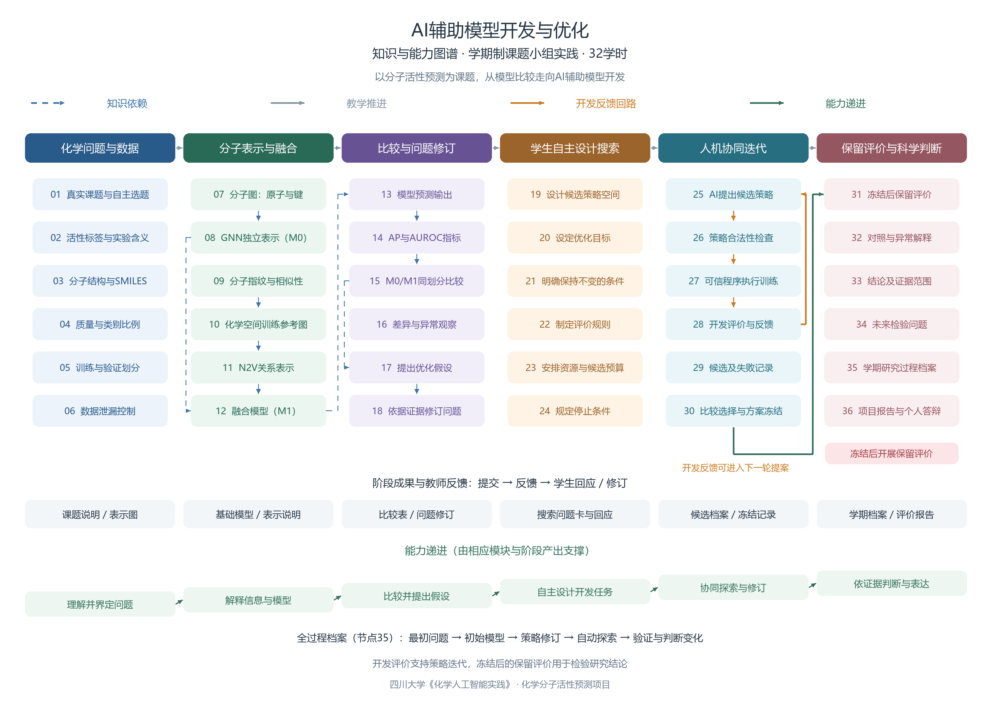

# 36节点知识／能力图谱v2与关系说明

图谱围绕GNN＋N2V课题小组的一学期32学时实践组织，连接知识学习、实践活动和能力发展。

## 图谱文件

高清PNG为 `assets/knowledge-map-v2.png`（3600×2550）；可编辑SVG为同名`.svg`；节点与关系数据为 `assets/knowledge-map-v2.json`，绘图源代码为 `scripts/build_knowledge_map.py`。

## 三类主要关系与开发反馈

| 关系 | 图上表达 | 实际含义 |
|---|---|---|
| 知识依赖 | 蓝色虚线及分支 | 原子／键分子图支持GNN独立表示；指纹相似性形成训练参考图并支持N2V；二者进入融合模型，再经同划分比较提出问题 |
| 教学过程 | 灰色模块箭头 | 六模块按学习需要衔接，五阶段32学时通过模块组合实施 |
| 能力递进 | 底部绿色阶梯与成果标签 | 从理解问题到解释模型、比较提问、自主设计、协同修订及科学判断，各自有阶段产出与教师反馈 |
| 开发迭代 | 橙色闭环25→26→27→28→25 | AI候选、合法检查、可信执行、开发评价反馈支持继续探索 |
| 冻结后评价 | 绿色30→31及红色禁止提示 | 学生选定并冻结方案后进行保留评价，结果不得返回当前搜索；未来问题另立研究轮次 |

节点35不是学期末才补的附件，而是贯穿问题提出、模型比较、搜索修订和验证的过程档案。机器关系数据用 `process_evidence` 将相应节点与35关联；为保证单页可读，图中用底部档案带表达，不把全部跨模块连线叠在节点上。

## 六模块与36个编号节点

| 模块 | 编号 | 主要节点与阶段成果 |
|---|---|---|
| 化学问题与数据 | 01—06 | 自主选题、标签、结构、数据质量、划分、防泄漏；产出课题说明 |
| 分子表示与融合 | 07—12 | 分子图、GNN/M0、指纹相似性、化学空间图、N2V、融合M1；产出表示说明 |
| 比较与问题修订 | 13—18 | 输出、指标、同划分比较、异常、假设与问题修订；产出比较表与问题变化 |
| 学生自主设计搜索 | 19—24 | 空间、目标、固定项、规则、预算、停止；产出问题卡与反馈回应 |
| 人机协同迭代 | 25—30 | AI提案、检查、执行、开发反馈、失败记录、选择冻结；产出候选档案 |
| 保留评价与科学判断 | 31—36 | 保留评价、异常、结论、未来问题、过程档案、答辩；产出学期报告 |

每模块的成果标签与能力标签不另外计入36个编号节点。阶段成果和学期档案共同呈现学生从理解问题到自主设计、协同探索与科学判断的发展。

重建需要Pillow和中文字体：`python scripts/build_knowledge_map.py --font "中文字体文件路径"`。本机使用微软雅黑生成，使用者可通过参数指定本机可用的中文字体。
